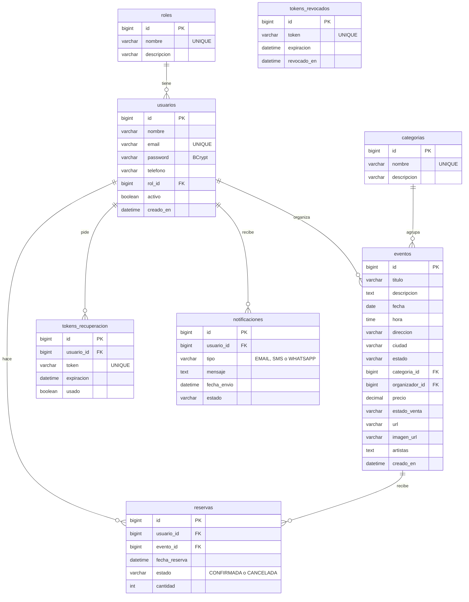

# CulturaVibe — Proyecto Final


Hola, yo soy **Perla Danae Gallardo Vasquez (GVPD)** y este es mi proyecto final de Programación Web, hecho junto con mi compañero **Ricardo Lemus Sánchez (LSR)**, equipo 13, con la maestra **Adelina Martinez**.

## Qué problema resuelve CulturaVibe

En México hay muchos eventos culturales — conciertos, obras de teatro, danza, arte y festivales — pero la información está regada en muchas páginas y no siempre es fácil saber qué hay cerca, cuánto cuesta o si todavía hay boletos. CulturaVibe junta todo en un solo lugar: yo puedo ver los eventos, buscar por categoría o por fecha, y apartar mi lugar con una reserva. Los organizadores pueden publicar sus eventos y los administradores llevan el control de todo el sistema.

Antes el proyecto solo mostraba eventos de Ticketmaster. Ahora ya es una aplicación completa (full stack): tiene su propio backend, su propia base de datos, cuentas de usuario con roles, reservas y avisos por correo, SMS y WhatsApp.

## Tecnologías que usé

**Backend**

- Java 17 y Spring Boot 3.5.16
- Spring Security con JWT (el token dura 24 horas)
- Spring Data JPA y Flyway (para las migraciones de la base de datos)
- MySQL 8 (base de datos `culturavibe_final`) y H2 para las pruebas
- JavaMailSender para enviar correos
- Vonage o Twilio para SMS y WhatsApp Cloud API (Meta, gratis) para WhatsApp

**Frontend**

- React 19 con Vite
- Tailwind CSS
- React Router

**Otras herramientas**

- Bruno para probar la API (no usamos Postman)
- GitHub y GitHub Projects para organizar el trabajo
- Figma para el prototipo
- Nginx, Postfix y Certbot / Let's Encrypt en el VPS

## Estructura del repo

```text
CulturaVibe-Final/
├── README.md
├── .gitignore
├── backend/                 # Spring Boot (puerto 8086)
│   ├── src/main/java/mx/culturavibe/final/
│   └── src/main/resources/
│       ├── application.properties
│       └── db/migration/    # Migraciones Flyway
├── frontend/                # React + Vite + Tailwind
│   ├── public/
│   │   └── logo.svg
│   └── src/
│       ├── pages/
│       ├── components/
│       └── services/
├── bruno/                   # Colección de Bruno para probar la API
│   ├── Auth/
│   ├── Eventos/
│   ├── Reservas/
│   └── environments/
└── db/
    └── respaldo.sql         # Respaldo de la base de datos
```

## URL base de la API

| Entorno | URL base |
| ------- | -------- |
| Local | http://localhost:8086 |
| VPS | http://13.140.226.55:8086 |

> Todavía no tenemos dominio ni HTTPS. Cuando lo tengamos, aquí va a ir la URL con `https://`. Por ahora la demo en vivo usa la IP del VPS con el puerto 8086.

## Qué puede hacer la API

Autenticación:

| Método | Ruta | Para qué sirve | Quién puede |
| ------ | ---- | -------------- | ----------- |
| POST | `/api/auth/register` | Crear una cuenta | Público |
| POST | `/api/auth/login` | Entrar y recibir el token JWT | Público |
| POST | `/api/auth/logout` | Salir (revoca el token) | Con sesión |
| POST | `/api/auth/forgot-password` | Pedir correo para recuperar la contraseña | Público |
| POST | `/api/auth/reset-password` | Cambiar la contraseña con el token del correo | Público |

Eventos:

| Método | Ruta | Para qué sirve | Quién puede |
| ------ | ---- | -------------- | ----------- |
| GET | `/api/eventos?page=0&size=12&categoria=1&q=concierto&fecha=2026-12-15` | Listar eventos con paginación y filtros | Público |
| GET | `/api/eventos/{id}` | Ver un evento | Público |
| POST | `/api/eventos` | Crear un evento | ADMIN y ORGANIZADOR |
| PUT | `/api/eventos/{id}` | Editar un evento | ADMIN y ORGANIZADOR |
| DELETE | `/api/eventos/{id}` | Borrar un evento | ADMIN |

Categorías:

| Método | Ruta | Para qué sirve | Quién puede |
| ------ | ---- | -------------- | ----------- |
| GET | `/api/categorias` | Listar categorías | Público |
| POST | `/api/categorias` | Crear una categoría | ADMIN |
| PUT | `/api/categorias/{id}` | Editar una categoría | ADMIN |
| DELETE | `/api/categorias/{id}` | Borrar una categoría | ADMIN |

Reservas:

| Método | Ruta | Para qué sirve | Quién puede |
| ------ | ---- | -------------- | ----------- |
| POST | `/api/reservas` | Crear una reserva | CLIENTE |
| GET | `/api/reservas/mis` | Ver mis reservas | CLIENTE |
| GET | `/api/reservas` | Ver todas las reservas | ADMIN y ORGANIZADOR |
| DELETE | `/api/reservas/{id}` | Cancelar una reserva | Dueño de la reserva o ADMIN |

Usuarios:

| Método | Ruta | Para qué sirve | Quién puede |
| ------ | ---- | -------------- | ----------- |
| GET | `/api/usuarios` | Listar usuarios | ADMIN |
| GET | `/api/usuarios/{id}` | Ver un usuario | ADMIN |
| PUT | `/api/usuarios/{id}` | Editar un usuario | ADMIN |
| DELETE | `/api/usuarios/{id}` | Borrar un usuario | ADMIN |

Para las rutas protegidas hay que mandar el token en el encabezado:

```text
Authorization: Bearer <tu_token>
```

Si no mandas token, la API responde `401`. Si tu rol no tiene permiso, responde `403`.

## Roles

Hay 3 roles en el sistema:

| Rol | Qué puede hacer |
| --- | --------------- |
| **ADMIN** | Todo: usuarios, categorías, eventos y reservas. |
| **ORGANIZADOR** | Crear y editar sus eventos y ver las reservas de sus eventos. |
| **CLIENTE** | Ver eventos y hacer o cancelar sus reservas. |

## Cuentas de prueba

Estas cuentas vienen en los datos de prueba (seed). Son solo para probar, no son cuentas reales:

| Rol | Correo | Contraseña |
| --- | -------- | ---------- |
| ADMIN | admin@culturavibe.mx | Admin123! |
| ORGANIZADOR | organizador@culturavibe.mx | Organizador123! |
| CLIENTE | cliente@culturavibe.mx | Cliente123! |

## Base de datos

La base de datos se llama `culturavibe_final` y tiene 8 tablas. Las migraciones se hacen con Flyway y los datos de prueba se cargan con el seed.

Datos de prueba (seed):

- 3 roles: ADMIN, ORGANIZADOR, CLIENTE
- 12 usuarios
- 5 categorías: Música, Teatro, Danza, Arte y Festivales
- 12 eventos
- 12 reservas

### Diagrama ER



La relación de muchos a muchos entre usuarios y eventos se hace con la tabla **reservas**: un usuario puede reservar muchos eventos y un evento puede tener muchas reservas.

## Cómo lo corro en local

### Lo que necesito antes

- Java 17
- Maven (en mi Windows uso `.\mvnw.cmd`, porque Maven no está instalado)
- Node.js y npm
- MySQL 8 corriendo en local (o usar el perfil de pruebas con H2)

### Backend

1. Entro a la carpeta del backend:

   ```bash
   cd backend
   ```

2. Creo el archivo `.env` con mis variables (nunca lo subo a GitHub):

   ```bash
   DB_URL=jdbc:mysql://localhost:3306/culturavibe_final
   DB_USER=root
   DB_PASSWORD=tu_contraseña
   JWT_SECRET=tu_secreto_jwt_en_base64url
   VONAGE_API_KEY=tu_api_key_de_vonage
   VONAGE_API_SECRET=tu_api_secret_de_vonage
   VONAGE_FROM_NUMBER=tu_numero_virtual_de_vonage
   TWILIO_ACCOUNT_SID=tu_sid_de_twilio
   TWILIO_AUTH_TOKEN=tu_token_de_twilio
   TWILIO_PHONE_NUMBER=tu_numero_de_twilio
   WHATSAPP_PHONE_NUMBER_ID=tu_phone_number_id
   WHATSAPP_ACCESS_TOKEN=tu_token_temporal_de_meta
   WHATSAPP_TEMPLATE_NAME=hello_world
   ```

   El correo en local usa Postfix en `localhost:25`, así que no necesita usuario ni contraseña.

3. Creo la base de datos en MySQL:

   ```sql
   CREATE DATABASE culturavibe_final CHARACTER SET utf8mb4;
   ```

4. Compilo y corro (Flyway crea las tablas y carga los datos de prueba solo):

   ```bash
   ./mvnw spring-boot:run
   ```

   En Windows (PowerShell):

   ```powershell
   .\mvnw.cmd spring-boot:run
   ```

   El backend queda en http://localhost:8086.

**Si no tengo MySQL, uso el perfil de pruebas con H2:**

```bash
./mvnw spring-boot:run -Dspring-boot.run.profiles=test
```

Con ese perfil la base de datos es en memoria y no necesito MySQL.

### Frontend

1. Entro a la carpeta del frontend:

   ```bash
   cd frontend
   ```

2. Creo el archivo `.env` con la URL de la API:

   ```bash
   VITE_API_URL=http://localhost:8086
   ```

3. Instalo las dependencias y corro el proyecto:

   ```bash
   npm install
   npm run dev
   ```

   El frontend queda en http://localhost:5173.

4. Para compilar la versión final:

   ```bash
   npm run build
   ```

   Eso genera la carpeta `dist/`.

## Cómo lo subo al VPS

El VPS es `13.140.226.55` (Ubuntu, con Java 21). Yo entro por SSH como `root`.

### Backend

1. Compilo el jar en mi computadora:

   ```powershell
   cd backend
   .\mvnw.cmd clean package -DskipTests
   ```

2. Subo el jar a la carpeta del proyecto final:

   ```powershell
   scp .\target\culturavibe-final-0.0.1-SNAPSHOT.jar root@13.140.226.55:/opt/springboot-final/
   ```

   Si la carpeta no existe, la creo antes en el VPS:

   ```bash
   mkdir -p /opt/springboot-final
   ```

3. En el VPS, creo el archivo `.env` en `/opt/springboot-final/` con las variables de entorno (las mismas de local, pero con los datos del servidor). Nunca subo ese archivo a GitHub.

4. Corro el backend con `nohup` (o con systemd, que es mejor porque se reinicia solo si se cae):

   ```bash
   cd /opt/springboot-final
   nohup java -jar culturavibe-final-0.0.1-SNAPSHOT.jar > app.log 2>&1 &
   ```

   Con systemd, el servicio se llama `culturavibe-final` y se maneja así:

   ```bash
   sudo systemctl start culturavibe-final
   sudo systemctl status culturavibe-final
   sudo systemctl enable culturavibe-final
   ```

5. Abro el puerto 8086 en el firewall:

   ```bash
   sudo ufw allow 8086
   ```

6. Compruebo que responde:

   ```bash
   curl http://localhost:8086/api/eventos
   ```

### Frontend

1. Compilo en local con la URL del VPS:

   ```bash
   cd frontend
   echo "VITE_API_URL=http://13.140.226.55:8086" > .env.production
   npm run build
   ```

2. Subo el `dist` al servidor:

   ```powershell
   scp -r .\dist\* root@13.140.226.55:/var/www/html/culturavibe/
   ```

3. En el VPS, Nginx sirve esa carpeta como archivos estáticos. La configuración de Nginx apunta a `/var/www/html/culturavibe/` y redirige todo a `index.html` para que funcione el router de React.

### Correo (Postfix)

El VPS ya tiene Postfix instalado y el backend manda los correos a `localhost:25`, sin usuario ni contraseña. Los correos que manda el sistema son: confirmación de registro, recuperación de contraseña y confirmación de reserva. Para que los correos no lleguen a spam, hay que configurar SPF y DKIM en el dominio cuando lo tengamos.

### HTTPS (Certbot / Let's Encrypt)

Todavía no tenemos dominio, así que todavía no hay HTTPS. Cuando tengamos el dominio, los pasos son:

```bash
sudo apt install certbot python3-certbot-nginx
sudo certbot --nginx -d tudominio.com
```

Certbot cambia solo la configuración de Nginx para usar HTTPS y renueva el certificado automáticamente.

## Cómo uso la colección de Bruno

La colección está en la carpeta `bruno/` y sirve para probar la API sin escribir código. Yo uso Bruno, no Postman.

1. Abro Bruno y abro la colección desde la carpeta `bruno/`.
2. Arriba a la derecha elijo el entorno: **Local** (http://localhost:8086) o **VPS** (http://13.140.226.55:8086).
3. Empiezo por la carpeta **Auth**:
   - **Login**: entra con la cuenta de admin y guarda el token solo en la variable `{{token}}`.
   - **Login cliente**: entra con la cuenta de cliente y guarda el token en `{{tokenCliente}}`. Esta petición hay que correrla antes de probar el caso de rol incorrecto y las reservas.
   - **Registro**: crea una cuenta nueva (responde 201) y también guarda el token.
   - **Logout**: cierra la sesión y revoca el token (responde 200).
4. Después pruebo la carpeta **Eventos**, en este orden:
   - **Listar eventos**: trae los eventos paginados (200). Es pública, no necesita token.
   - **Ver evento**: trae un evento por su id (200).
   - **Crear evento**: crea un evento con el token de admin (201) y guarda el id en `{{eventoId}}`.
   - **Validacion**: manda un cuerpo sin título ni fecha y debe responder 400.
   - **No encontrado**: pide el evento 999999 y debe responder 404.
   - **Sin token**: intenta crear un evento sin token y debe responder 401.
   - **Rol incorrecto**: intenta crear un evento con el token de cliente y debe responder 403. Antes hay que correr **Login cliente**.
5. Al final pruebo la carpeta **Reservas** (todas usan el token de cliente):
   - **Crear reserva**: reserva 2 lugares del evento 1 (201) y guarda el id en `{{reservaId}}`.
   - **Listar mis reservas**: trae solo mis reservas (200).
   - **Cancelar reserva**: cancela la reserva que se acaba de crear (200).

Cada petición ya trae su método, su URL con `{{baseUrl}}` y `{{token}}`, sus encabezados y un cuerpo JSON de ejemplo. Las peticiones de error ya traen su prueba que revisa el código de respuesta.

## Comunicación: correo, SMS y WhatsApp

Cuando alguien se registra, recupera su contraseña o hace una reserva, el sistema le avisa. Todo queda guardado en la tabla `notificaciones`.

| Canal | Cómo se manda | Para qué se usa |
| ----- | ------------- | --------------- |
| Correo | JavaMailSender a Postfix local (`localhost:25`) | Confirmar registro, recuperar contraseña y confirmar reserva |
| SMS | Vonage (primero) o Twilio (respaldo) | Avisar de la reserva y de cambios en el evento |
| WhatsApp | WhatsApp Cloud API (Meta, gratis) | Lo mismo que el SMS, para quien prefiera WhatsApp |

Para el SMS uso Vonage, porque Twilio trial no deja comprar número sin actualizar a cuenta de paga. Vonage tiene prueba gratis con un número virtual incluido. Se configura así:

1. Creo una cuenta en [Vonage](https://dashboard.nexmo.com/sign-up) (prueba gratis, con crédito de bienvenida).
2. En el dashboard voy a **API Settings** y copio la **API key** y el **API secret**.
3. En **Numbers → Buy numbers** compro un número virtual (va con cargo al crédito de la prueba).
4. Pongo estas variables en el `.env` (nunca en el código ni en GitHub):

```bash
VONAGE_API_KEY=tu_api_key_de_vonage
VONAGE_API_SECRET=tu_api_secret_de_vonage
VONAGE_FROM_NUMBER=tu_numero_virtual_de_vonage
```

Si Vonage no está configurado, el SMS sale por Twilio como respaldo, con estas variables:

```bash
TWILIO_ACCOUNT_SID=tu_sid_de_twilio
TWILIO_AUTH_TOKEN=tu_token_de_twilio
TWILIO_PHONE_NUMBER=tu_numero_de_twilio
```

Ojo: en trial Twilio pide actualizar a cuenta de paga (mínimo $20 USD de recarga) y un perfil de compliance para comprar número, por eso Vonage va primero.

Para el WhatsApp uso la Cloud API de Meta, que es gratis y no necesita comprar número. Se configura así:

1. Entro a [developers.facebook.com](https://developers.facebook.com), creo una app y agrego el producto **WhatsApp**.
2. Ahí me dan un **número de prueba** y un **token temporal** (dura 24 horas); el token se renueva desde esa misma página.
3. La plantilla que uso es `hello_world`, que ya viene en la app y no necesita aprobación.
4. Pongo estas variables en el `.env` (nunca en el código ni en GitHub):

```bash
WHATSAPP_PHONE_NUMBER_ID=tu_phone_number_id
WHATSAPP_ACCESS_TOKEN=tu_token_temporal_de_meta
WHATSAPP_TEMPLATE_NAME=hello_world
```

En local, si no tengo Vonage/Twilio o WhatsApp configurados, el sistema guarda la notificación como pendiente y no se cae por eso.

## Diseño en Figma

### Prototipo navegable (interactivo)

El prototipo que entregamos es la versión interactiva en Figma Make: se puede iniciar sesión por rol, navegar el catálogo, ver el detalle de cada evento, reservar y cancelar.

- **Prototipo interactivo (Figma Make):** https://www.figma.com/make/3waxMGvbiyFrp9BJumGEV3/Estilo-Visual-y-Pantallas?p=f&t=qfPXeg4mVMO9VEHx-0

### Paleta de colores

Nuestra paleta es negro (#050505) como base, violeta (#8B5CF6) como color principal y fucsia (#D946EF) como acento, con texto claro (#F8FAFC). Es una paleta análoga: violeta y fucsia son colores vecinos en el círculo cromático, por eso armonizan sin chocar. El negro da contraste y hace resaltar los acentos, además de dar elegancia y reducir la fatiga visual. El violeta se asocia con la creatividad y la cultura, y el fucsia aporta energía y juventud, justo lo que representa CulturaVibe. El texto claro sobre fondo oscuro garantiza un contraste alto y buena legibilidad. La aplicación usa exactamente esta misma paleta, por eso el diseño se ve igual en el prototipo y en la app.

### Logo

El logo es original del equipo: está arriba de este README y en `frontend/public/logo.svg`, con el mismo degradado de violeta a fucsia de la paleta.

## Tablero de GitHub Projects

TODO: pegar aquí el link al tablero de GitHub Projects

## Notas de seguridad

Estas son las reglas que seguimos en el equipo para no exponer nada:

- **Nunca subo secretos a GitHub**: ni contraseñas de la base de datos, ni el secreto del JWT, ni las claves de Twilio ni el token de WhatsApp. Todo eso va en variables de entorno o en el archivo `.env`, y el `.env` está en el `.gitignore`.
- **Las contraseñas se guardan con BCrypt**, nunca en texto plano, y nunca se devuelven en las respuestas de la API.
- **El token JWT dura 24 horas** y al hacer logout se guarda en la tabla `tokens_revocados` para que ya no sirva.
- **La contraseña debe tener mínimo 8 caracteres**, con mayúscula, número y carácter especial.
- **Las cuentas de prueba de arriba son solo para probar** y viven en los datos de prueba. En producción no deben existir.
- **El `.gitignore` ya cubre** `node_modules/`, `dist/`, `target/`, `.env`, los archivos `*.log`, `.DS_Store`, `.idea/`, `*.iml`, `.vscode/` y cualquier archivo con secretos (`*.pem`, `*.key`, `*.p12`, `*.jks`).
- **La llave de Ticketmaster no va en el repo**: si el frontend la necesita, va en el `.env` como `VITE_TICKETMASTER_API_KEY`.

## Equipo 13

- **Perla Danae Gallardo Vasquez (GVPD)** — GitHub: PerlaD391
- **Ricardo Lemus Sánchez (LSR)**

Proyecto Final de Programación Web — Instituto Tecnológico de Oaxaca — Entrega: lunes 24 de noviembre de 2026, 23:59, con demo en vivo.
